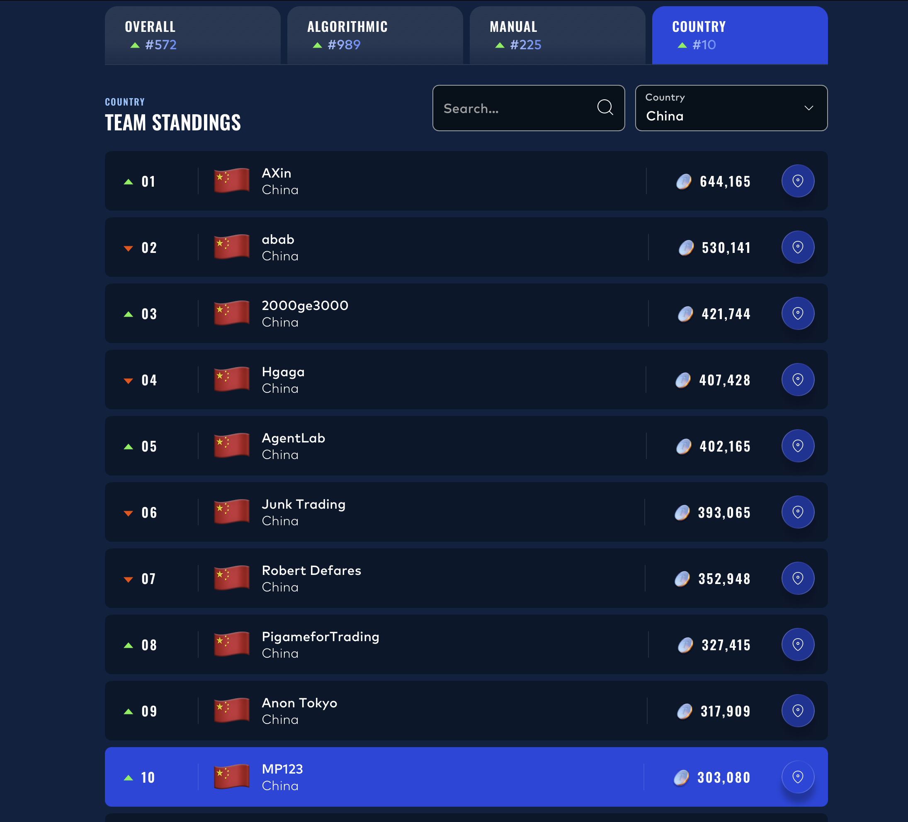

# IMC Prosperity 4 — Trading Competition & Research Retrospective

<div align="center">

**Overall #572 / 18,803 (Top 3.1%) · China #10 · 303,080 XIRECs**

**Algorithmic #989 · Manual #225**

</div>

<p align="center">
  <br>
  <sub>Final IMC Prosperity 4 leaderboard</sub>
</p>

## Competition Overview

IMC Prosperity 4 combined five evolving algorithmic markets with five manual decision,
game-theoretic, and portfolio-construction rounds. Across the competition, I built Python
trading algorithms, made portfolio decisions under position and transaction-cost constraints,
and later reconstructed the algorithmic rounds from the original source and exchange logs for
a post-competition research retrospective.

<details>
<summary><b>Competition scale</b> — 18,803 teams, 30,703 players, 117 countries</summary>
<br>
<p align="center">
  <br>
  <sub>1,549 universities · 556,223 Python programs uploaded · 44,317 manual submissions</sub>
</p>
</details>

<details>
<summary><b>China standings</b> — #10</summary>
<br>
<p align="center"></p>
</details>

## What I Built / Researched

- Python trading algorithms for fair-value estimation, quoting, directional signals, inventory
  management, and position-limit enforcement.
- A consistent market-diagnostics battery covering variance ratios, autocorrelation decay,
  deterministic trends, random walks, and mean reversion.
- Option-pricing and portfolio analysis using Black-Scholes, implied-volatility structure,
  intrinsic-value identities, payoff decomposition, and constrained sizing.
- Order-book and execution research connecting spread, aggressor flow, liquidity, inventory,
  and crossing cost to realizable edge.
- Cross-asset analysis that distinguishes fitted relationships from stationary spreads and
  exact basket identities.
- Day-by-day robustness checks designed to prevent pooled results from masking regime changes.
- Manual optimization across auctions, strategic bidding, game-theoretic allocation, option
  portfolios, and news-driven portfolio construction.

The research notebooks, round reports, original submissions, and replay tooling are kept in
this repository so that claims can be traced to their supporting evidence.

## Selected Results

| Result | Performance |
|---|---:|
| Overall | **#572 / 18,803 (Top 3.1%)** |
| China | **#10** |
| Manual track | **#225** |
| Algorithmic track | **#989** |
| Total score | **303,080 XIRECs** |
| Manual Round 4 — option portfolio | **72,278 · #178** |
| Manual Round 5 — news-driven allocation | **82,623 · #538** |
| Manual Round 3 — strategic bidding | **70,444 · #442** |

Across the three manually scored rounds reported individually, the manual track contributed
**225,345 XIRECs**, versus **77,736 XIRECs** from the algorithmic track. Manual Round 4 was my
best single-round rank across either track; Manual Round 5 was my largest single manual score.

## Research Highlights

1. **A fitted relationship is not necessarily a stationary one.** In Round 5, all five traded
   pair spreads had variance ratios near the random-walk benchmark, while the one exact
   five-product identity was stable across days. [Round 5 analysis](rounds/05/)
2. **A low variance ratio alone does not establish tradeable mean reversion.** Autocorrelation
   decay separated persistent reversion from short-lived residual noise that disappeared before
   it could be traded. [Round 1 analysis](rounds/01/)
3. **Structural identity can improve fair value without creating executable arbitrage.** The
   deep-in-the-money option basis in Round 3 and the PEBBLES basket in Round 5 were highly stable,
   but their deviations were dominated by multi-leg execution costs. [Round 3](rounds/03/) ·
   [Round 5](rounds/05/)
4. **Statistical significance and tradeability both require robustness checks.** Round 4 showed
   how pooling observations across days could create an apparent counterparty signal; Round 5
   showed that even a repeatable forecast must clear spread and liquidity costs before it can be
   crossed on. [Round 4](rounds/04/) · [Round 5](rounds/05/)

## Representative Case — Manual Round 4 Option Portfolio

**Market / problem.** Construct a portfolio from twelve derivatives on an underlying priced at
50 with 251% annualized volatility. The set included vanilla options at two maturities, a
chooser, a binary put, and a knockout put, with contract-specific position limits. Performance
was evaluated over the average payoff of 100 simulated paths.

**Analysis and model.** I decomposed the chooser using the identity
$\text{Chooser}(\text{ATM}, r=0)=C(3w,50)+P(2w,50)$, used the three-week 50-call as the natural
hedge for the short chooser, and evaluated the remaining contracts through payoff shape,
relative value, and portfolio interaction.

**Portfolio decision.** The submitted portfolio expressed seven active long/short positions,
including a short chooser, a long three-week ATM call hedge, and positions in the binary and
knockout structures, while respecting the per-contract limits.

**Result.** The portfolio scored **72,278 XIRECs and ranked #178**, the best single-round rank of
my competition across either track and a top-1% round result.

**Retrospective validation.** Five of the seven active legs matched the contract, direction, and
limit-sized position of a 57th-place comparison portfolio. The review then isolated the remaining
sizing differences and used the chooser decomposition to separate hedging from residual
directional exposure. [Full manual analysis](manual/#round-4--the-option-portfolio)

## Manual Trading

The manual track was a distinct and meaningful part of the competition result: **#225 overall**.
It tested optimization and portfolio judgment where the payoff depended on nonlinear costs,
other teams' decisions, or multi-contract interactions.

- **Round 3 — strategic bidding:** 70,444 XIRECs, **#442**. The first bid matched the discrete
  optimum; the surviving Monte Carlo and best-response notebook also located the second-bid
  equilibrium range used in the retrospective.
- **Round 4 — option portfolio:** 72,278 XIRECs, **#178**. This was the strongest single-round
  rank across both tracks.
- **Round 5 — news-driven allocation:** 82,623 XIRECs, **#538**. This was the largest single
  manual contribution, with allocation assessed against an exact quadratic-cost sizing rule.

[Read the complete manual-track review](manual/).

## Round-by-Round Archive

| Round | Market theme | Main research topic | Key validated takeaway | Evidence |
|---|---|---|---|---|
| **1** | Trend and mean reversion | Process classification; fair value; book imbalance | Deterministic trend and persistent mean reversion require different policies; autocorrelation decay distinguishes persistence from noise | [research](rounds/01/) · [notebook](research/round1.ipynb) · [replay](rounds/01/replay/) · [submission](submissions/round1.py) |
| **2** | Same markets, new day | Parameter stability and regime robustness | Structural identities transferred across days; estimated dynamics required revalidation | [research](rounds/02/) · [notebook](research/round2.ipynb) · [replay](rounds/02/replay/) · [submission](submissions/round2.py) |
| **3** | Spot plus ten option strikes | Option fair value, intrinsic identities, flow economics | Stable option relationships improved fair value, while execution cost determined whether the edge was tradeable | [research](rounds/03/) · [notebook](research/round3.ipynb) · [replay](rounds/03/replay/) · [submission](submissions/round3.py) |
| **4** | Counterparty identities revealed | Conditional flow signals and day-level robustness | Counterparty effects had to remain stable by day; pooled significance alone was insufficient | [research](rounds/04/) · [notebook](research/round4.ipynb) · [replay](rounds/04/replay/) · [submission](submissions/round4.py) |
| **5** | Fifty products in ten groups | Cross-asset structure, breadth, and execution cost | One exact basket identity survived validation; fitted pairs did not, and signal size had to be compared with crossing cost | [research](rounds/05/) · [notebook](research/round5.ipynb) · [replay](rounds/05/replay/) · [submission](submissions/round5.py) |

## Validation / Replay

The retrospective is checked against the original submitted source and the exchange logs rather
than a rewritten approximation. Across Rounds 1–4, the replay explains **99.8–100% of observed
exchange fills** at compatible timestamps, sides, and prices. Round 3 provides an independent
order-state check: **9,986 / 10,000 timestamps** match the orders recorded by the submission.
Interactive examples: [R1 ASH](rounds/01/replay/ash.html) ·
[R2 ROOT](rounds/02/replay/root.html) · [R3 HYDROGEL_PACK](rounds/03/replay/pack.html).

## Repository Structure

```text
rounds/01..05/     detailed round reports, specifications, and interactive replays
research/          notebooks for loading, testing, plotting, and deriving conclusions
submissions/       original competition submissions, preserved unmodified
tools/             replay engine, research battery, and benchmarks
manual/            manual-track submissions, results, and retrospective analysis
assets/            leaderboard images and notebook-generated figures
data/              instructions for obtaining the market data
```

## Limitations

- **Competition results** are the original scores and ranks reported by the platform and exchange
  logs; they are not revised or hypothetical.
- **Retrospective findings** were produced after the competition from the preserved submissions,
  logs, and notebooks. They explain and evaluate the markets but are not presented as
  competition-time decisions.
- **Counterfactual strategy figures** come from fixed-tape simulation. Because the recorded
  market cannot react to a different strategy, these figures support controlled comparisons,
  not claims about a hypothetical live rank.
